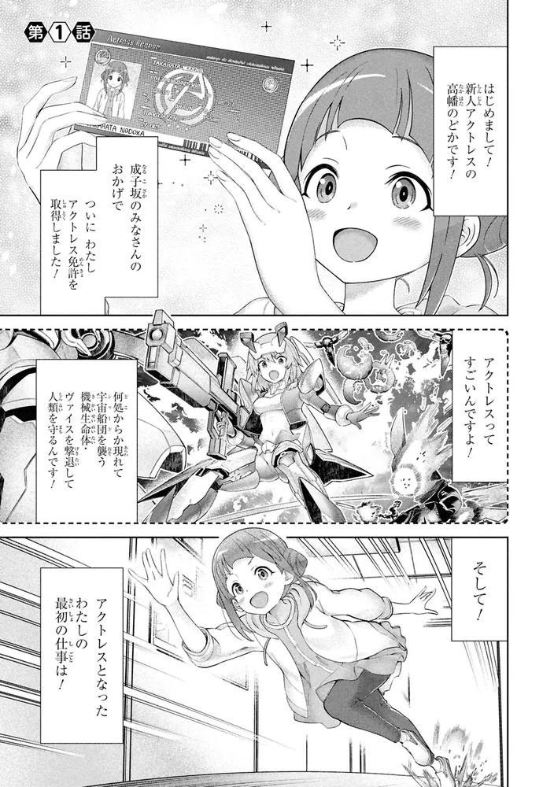

# AI漫画翻译

## 环境要求

- Nvidia 8G+ VRAM（仅本地 LLM 翻译需要；用阿里云机器翻译可不依赖显卡）

## 安装模型

1. Python3.10
2. PaddleOCR
```
pip install paddlepaddle paddleocr
```
3. 翻译后端二选一（可同时配置，优先 LM Studio，失败自动回退阿里云）

### A. LM Studio（本地）
- 翻译：Sakura-14B-Qwen2.5-v1.0-GGUF
```
hf download SakuraLLM/Sakura-14B-Qwen2.5-v1.0-GGUF sakura-14b-qwen2.5-v1.0-q4km.gguf
```
- 备选：Hy-MT2

### B. 阿里云机器翻译（无 LM Studio 时）
- 开通 [机器翻译](https://www.aliyun.com/product/ai/alimt) 通用版
- 用 RAM 用户 AccessKey（推荐）或主账号 AK
- 环境变量或命令行传入：
  - `ALIBABA_CLOUD_ACCESS_KEY_ID`
  - `ALIBABA_CLOUD_ACCESS_KEY_SECRET`

## 部署步骤

### 有 LM Studio
1. 打开 LM Studio，加载 Sakura。
2. 到 Model Server 页面，把服务器状态切到 Running，确认地址是 http://127.0.0.1:1234。
3. 运行：
```
python manga_ocr.py --lang japan --llm-model sakura-14b-qwen2.5-v1.0-q4km
```

### 仅用阿里云机器翻译（无 LM Studio）
```
python manga_ocr.py --lang japan --force-aliyun --aliyun-ak 你的AccessKeyId --aliyun-sk 你的AccessKeySecret
```
或先设置环境变量再：
```
python manga_ocr.py --lang japan --force-aliyun
```

也可不强制：同时配置 AK/SK 后，LM Studio 连不上会自动回退阿里云。

4. 浏览器会自动打开 http://127.0.0.1:7860，把日文漫画拖进去，等文字框出来，点"翻译"，再点"保存译图"。

> 输入
> 
>
>
> 输出
> 
>
